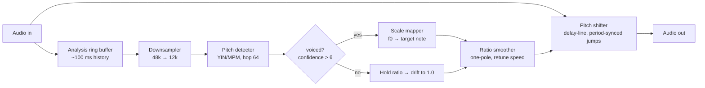

# Simple Live Tune — Architecture & Implementation Plan

A real-time pitch-correction (autotune) plugin with **zero added plugin latency**.
Target formats: **AU + VST3** (via JUCE), macOS first.

---

## 1. Design goals

| Goal | Target |
|---|---|
| Added plugin latency | **0 samples** (report `latencySamples = 0` to host) |
| Correction reaction lag | ≤ 1 detection window (~35–50 ms), masked by retune smoothing |
| Pitch range | ~70 Hz (D2) – 1000 Hz (B5), covers vocals |
| CPU | Well under 5% of one core at 48 kHz / 64-sample buffers |
| Block-size independence | Works identically at any host buffer size (1–4096 samples) |

### Core principle: the audio path is never buffered for analysis

- **Pitch detection** runs on a *trailing* window of already-output samples.
  Its result controls the *current* shifter state. Detection window length is a
  *control-signal lag*, not audio latency.
- **Pitch shifting** uses a pitch-synchronous variable-rate delay line
  (Autotalent / zita-at1 technique), which adds no algorithmic delay — unlike
  phase-vocoder/FFT approaches (20–90 ms + smearing).

---

## 2. Signal flow



Two independent rates:
- **Audio rate**: input → shifter → output, per sample.
- **Control rate**: every hop (64 samples), the detector updates `f0` and
  `confidence`; the mapper/smoother update the target pitch ratio.

---

## 3. Module breakdown

All DSP modules are plain C++ (no JUCE dependency) so they are unit-testable
and reusable in a CLI harness.

```
simple-live-tune/
├── ARCHITECTURE.md
├── CMakeLists.txt
├── src/
│   ├── dsp/
│   │   ├── RingBuffer.h          # lock-free single-writer circular buffer
│   │   ├── Downsampler.{h,cpp}   # 48k → 12k polyphase decimator for analysis
│   │   ├── PitchDetector.{h,cpp} # MPM/YIN, incremental, trailing window
│   │   ├── ScaleMapper.{h,cpp}   # f0 → nearest allowed note → target ratio
│   │   ├── RatioSmoother.{h,cpp} # retune-speed one-pole in log-pitch domain
│   │   └── PitchShifter.{h,cpp}  # delay-line shifter w/ period-sync jumps
│   ├── engine/
│   │   └── TuneEngine.{h,cpp}    # wires modules, sample-loop, control hop
│   └── plugin/
│       ├── PluginProcessor.{h,cpp}  # JUCE AudioProcessor (AU/VST3)
│       └── PluginEditor.{h,cpp}     # UI (phase 2; generic editor first)
├── tests/
│   ├── test_pitch_detector.cpp   # synthetic sines/sawtooths, noise, sweeps
│   ├── test_pitch_shifter.cpp    # ratio accuracy, click detection, latency=0
│   └── test_engine.cpp           # end-to-end: detuned input → in-tune output
└── tools/
    └── offline_tune.cpp          # CLI: WAV in → WAV out, for A/B listening
```

### 3.1 PitchDetector (control path)
- **Algorithm**: MPM (McLeod Pitch Method) — NSDF + peak picking; better
  octave-error behavior than plain autocorrelation. YIN as fallback/reference.
- **Input**: analysis ring buffer, downsampled to 12 kHz (fundamentals of
  interest ≤ 1 kHz → generous margin; 4× less CPU, better time resolution
  per FLOP).
- **Window**: ~35 ms (2.5 periods of 70 Hz at 12 kHz ≈ 420 samples).
  **Hop**: 64 samples at audio rate.
- **Outputs**: `f0` (Hz), `confidence` (NSDF peak clarity 0–1), `voiced` flag.
- **Unvoiced handling**: below confidence threshold (breaths, consonants,
  silence) → no correction; smoother drifts ratio back toward 1.0.
- The first complete window initializes the NSDF correlation cache. Subsequent
  overlapping windows update it by removing the outgoing hop and adding the
  incoming hop, reducing recurring work from `O(window × maxLag)` to
  `O(hop × maxLag)` without allocating on the audio thread.

### 3.2 ScaleMapper
- Inputs: `f0`, key/scale selection (chromatic, major, minor, custom mask of
  12 semitones), optional MIDI target-note override (phase 3).
- Output: target frequency = nearest allowed note (in cents/log domain).
- Hysteresis of ~±60 cents around the current note to prevent flutter at
  note boundaries.

### 3.3 RatioSmoother
- Works in **log-pitch (cents)** domain: `smoothed += α * (target − smoothed)`.
- `α` derived from **Retune Speed** parameter (0 ms = hard snap /
  robot effect, ~50–400 ms = natural).
- Separate faster time constant for note *transitions* vs. within-note drift
  (classic autotune feel) — phase 2 refinement.

### 3.4 PitchShifter (audio path — the zero-latency core)
Pitch-synchronous delay-line resampling:
- Short circular buffer (~4096 samples). Write head at input rate.
- Read head advances at `ratio` (fractional, cubic/Hermite interpolation).
- Read head drifts relative to write head; when headroom is exhausted, it
  **jumps by exactly one detected pitch period** (`P = sampleRate / f0`)
  and **crossfades** over a few ms (raised cosine) between old and new tap.
- Period-synchronous jumps keep the waveform phase-continuous → no clicks,
  no phasiness, no FFT smearing.
- **Latency**: read head sits at/near the write head → 0 added samples.
  (Shifting up requires < 1 period of instantaneous headroom, handled by the
  jump logic, not by delaying the whole stream.)
- Unvoiced/no-f0 case: ratio ≈ 1.0, no jumps → bit-transparent passthrough.

### 3.5 TuneEngine
- Owns all modules; `process(const float* in, float* out, int n)`.
- Runs the per-sample audio loop; every 64 samples fires the control hop
  (detector → mapper → smoother).
- No allocations, locks, or syscalls in the audio thread. Parameters come in
  via atomics/FIFO from the plugin wrapper.

### 3.6 Plugin wrapper (JUCE)
- `AudioProcessor` reporting **0 latency**; mono-in/mono-out first
  (stereo-linked later).
- Parameters (APVTS): Key, Scale, Retune Speed, Correction Amount (dry/wet in
  pitch domain), Confidence Threshold, Bypass.
- UI phase 1: JUCE generic editor. Phase 2: custom editor with pitch display
  (input pitch vs. corrected pitch trace).

---

## 4. Latency budget

| Stage | Added audio latency |
|---|---|
| Analysis ring buffer | 0 (parallel tap, not in signal path) |
| Pitch detector | 0 (control lag only, ~35 ms reaction) |
| Delay-line shifter | 0 samples reported; worst case < 1 pitch period of transient headroom during upward jumps |
| Plugin wrapper | 0 (no internal FIFO) |
| **Total plugin latency** | **0 samples** |

End-to-end live latency = host I/O buffer only (64 samples @ 48 kHz ≈ 1.3 ms).

---

## 5. Testing & validation strategy

1. **Unit tests** (CTest + a small header-only framework or GoogleTest):
   - Detector: accuracy < ±5 cents on synthetic tones 70–1000 Hz, robustness
     to noise, octave-error rate on sawtooth/vocal-like signals, sweep tracking.
   - Shifter: output pitch = input pitch × ratio (verified by the detector
     itself), THD/click metric across jump points, verify 0-sample latency via
     impulse/cross-correlation.
2. **Offline CLI tool** (`tools/offline_tune`): process WAV files of real
   vocals for A/B listening without a DAW.
3. **Live testing**: build with `-DCMAKE_BUILD_TYPE=Release`, load the AU into
   `simple-au-host` (existing project) for fast iteration with a mic, and fully
   restart the host after installing a new component; then test Logic/Ableton
   for host compatibility. Never use an unoptimized build to judge live
   stability.
4. **CPU/RT-safety**: assert no allocations in the audio thread (custom
   allocator guard in debug builds). Profile an optimized Release build at 32-
   and 64-sample buffers, checking peak callback time—not only average CPU—
   against the hardware deadline.

Reference implementations to study (clean-room only — both are GPL, so no
code may be copied or ported unless Simple Live Tune itself adopts GPL):
- **Autotalent** (Tom Baran, GPL-2) — single-file C, same shifting scheme.
- **zita-at1** (Fons Adriaensen, GPL-3) — high-quality low-latency retuner.

---

## 6. Implementation phases

### Phase 1 — Core DSP, offline (no plugin yet)
1. CMake skeleton, RingBuffer, Downsampler.
2. PitchDetector (MPM) + unit tests against synthetic signals.
3. PitchShifter + unit tests (fixed ratio first, then live-period jumps).
4. TuneEngine + offline CLI tool; validate on real vocal recordings.
**Exit criteria**: detuned vocal WAV comes out in tune, no audible clicks.

### Phase 2 — Plugin
5. JUCE wrapper (AU/VST3), APVTS parameters, generic editor, 0-latency report.
6. Live test in simple-au-host + Logic; tune retune-speed feel, hysteresis.
**Exit criteria**: live mic → in-tune output at 64-sample buffer, stable in hosts.

### Phase 3 — Polish
7. Custom UI with pitch trace display.
8. Note-transition speed vs. in-note drift split; vibrato preservation control.
9. MIDI note targeting; stereo link; formant preservation (research spike —
   likely PSOLA-domain formant correction, may cost some quality; optional).

---

## 7. Key risks & mitigations

- **Octave errors in detection** → MPM clarity threshold + continuity prior
  (prefer f0 near previous estimate); test suite with known-hard signals.
- **Clicks at jump points** → period-synchronous jumps + raised-cosine
  crossfade; automated click detector in tests.
- **Latency creep via convenience buffering** → tests assert 0-sample latency
  end-to-end; block-size-independence test (process same input with n=1 vs
  n=4096, outputs must match).
- **Formant shift ("chipmunk") on large corrections** → acceptable for ±2
  semitones; formant preservation deferred to phase 3.
